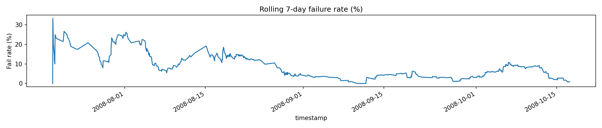
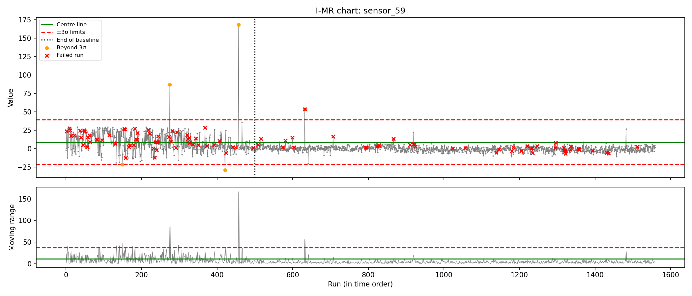

# Statistical Process Control Analysis of Semiconductor Manufacturing Data

Applying statistical process control (SPC) techniques in Python to real production data from a semiconductor manufacturing line, to identify process variables linked to product failures and assess process stability.

## Data
SECOM dataset: 1,567 production runs (July–October 2008), 590 sensor measurements per run, pass/fail labels with timestamps. Available from the UCI Machine Learning Repository: https://archive.ics.uci.edu/dataset/179/secom

Download and unzip it into a `data/` folder before running the notebooks.

McCann, M. & Johnston, A. (2008). SECOM [Dataset]. UCI Machine Learning Repository. https://doi.org/10.24432/C54305

## Approach (DMAIC)

**Define:** 6.6% of production runs fail end-of-line testing. Goal: identify which process variables are linked to failures and whether the process is in statistical control.

**Measure** (`notebooks/01_data_cleaning.ipynb`): Removed 28 sensors with more than 50% missing data and 116 constant sensors, leaving 446.

**Analyse** (`notebooks/02_failure_analysis.ipynb`, `notebooks/03_control_charts.ipynb`):
- Compared every sensor between passed and failed runs (Mann–Whitney U test, Benjamini–Hochberg correction for multiple testing). **20 sensors** differ significantly; effects are moderate (effect sizes ~0.2–0.4).
- Built Individuals and Moving Range (I-MR) control charts with Western Electric rules for the four strongest sensors.
- The initial charts gave a counterintuitive result: runs flagged as out of control failed *less* often. Investigation found a **process change on 21 August 2008**, after which the failure rate fell from **14.2% to 4.3%**, and all four sensors shifted away from failure-associated levels. The original baseline described the poorer, pre-change process.
- Re-baselining on the post-change period brought most sensors close to expected in-control behaviour.

**Improve:** In a real setting, the next step would be to identify what changed on 21 August (e.g. maintenance, recipe or material change), confirm it as the cause, and standardise it.

**Control:** Monitor the key sensors using control limits from the stable post-change period. sensor_28 would need a different approach, as it drifts in a way standard I-MR limits do not capture.

## Key results

Rolling 7-day failure rate, showing the drop after the process change:



Control chart for sensor_59 using the original baseline, showing the shift in the process:



## Limitations
- Failures were concentrated before the process change, so part of each sensor's association with failure may reflect timing rather than a direct effect.
- Only ~40 failures occur after the change, limiting the power to link post-change control signals to failures.
- The dataset has no specification limits, so process capability (Cp/Cpk) was not assessed.
- Sensors are anonymised, so findings cannot be linked to specific physical process steps.

## Repository structure
```
notebooks/
  01_data_cleaning.ipynb      load, explore and clean the data
  02_failure_analysis.ipynb   identify sensors associated with failures
  03_control_charts.ipynb     control charts, change-point detection, re-baselining
results/                      saved figures
requirements.txt
```

## Tools
Python, pandas, NumPy, SciPy, Matplotlib, Jupyter
